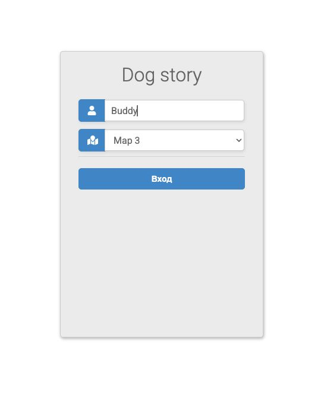
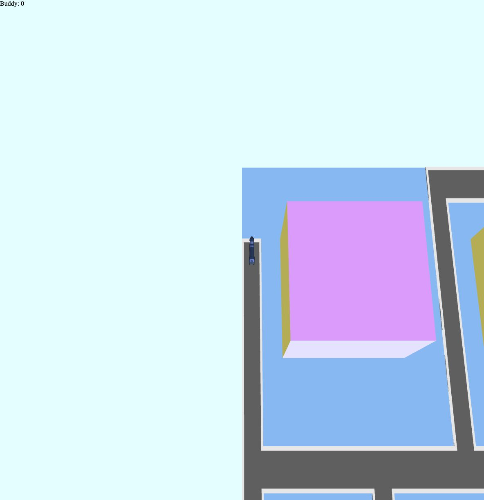

# Dog Story — C++ Game Server

A multiplayer browser game about dogs collecting items and delivering them for
points. Choose one of three maps and play locally with a C++20 server and PostgreSQL.

[Quick start](#quick-start) · [Docker guide](docs/docker.md) · [Documentation](#documentation)

## Requirements

- **Windows or macOS:** Docker Desktop ([Windows installation](https://docs.docker.com/desktop/setup/install/windows-install/),
  [macOS installation](https://docs.docker.com/desktop/setup/install/mac-install/)), running in Linux containers mode.
- **Linux:** [Docker Engine](https://docs.docker.com/engine/install/) with the
  [Docker Compose plugin](https://docs.docker.com/compose/install/linux/) and a running Docker daemon.
- An Intel/AMD 64-bit (`amd64`) or ARM64 machine, including Apple Silicon.
- Internet access for the first build and a browser with WebGL support.

Build and runtime resource measurements are listed in the [Docker guide](docs/docker.md#resources).
You do not need to install a compiler, Conan, or PostgreSQL on the host.

## Quick start

1. Clone the repository and enter its directory:

   ```sh
   git clone https://github.com/ALLeksandrOrlov/dog-story-server.git
   cd dog-story-server
   ```

   Alternatively, download and extract the repository ZIP, then open a terminal
   in the extracted directory containing `compose.yaml`.
2. Create a local settings file. In PowerShell on Windows:

   ```powershell
   Copy-Item .env.example .env
   ```

   On macOS or Linux:

   ```sh
   cp .env.example .env
   ```

   Open `.env` in a text editor and set `POSTGRES_PASSWORD` to your own
   password using letters, digits, hyphens, and underscores. These characters are
   safe in the database URL.
3. Build and start the game and PostgreSQL:

   ```sh
   docker compose up -d --build
   ```

   The first build downloads and compiles dependencies and can take several
   minutes. Later builds reuse the cache.
4. Open [localhost:8080](http://localhost:8080), enter a name, and select a map.
   If the page is not ready immediately, wait a moment and refresh.

Use the arrow keys to move, collect items, and take them to delivery points to score.
An inactive player leaves the game after 15 seconds by default; their result then
appears on the leaderboard.

If port 8080 is busy, add `GAME_HTTP_PORT=8081` to `.env`, run
`docker compose up -d`, and open [localhost:8081](http://localhost:8081).

## Stop, restart, and check status

Run these commands from the repository root:

```sh
docker compose down          # Stop the stack and keep saved data
docker compose up -d         # Start it again
docker compose restart game  # Restart only the game server
docker compose ps            # Check service status
docker compose logs -f game  # Follow the game logs; Ctrl+C exits
```

Records and active game state are preserved in Docker volumes. Keep the password
in `.env` unchanged when reusing the database. **`docker compose down -v` deletes
saved game data.** The game is available only on this machine by default;
PostgreSQL has no published host port.

For startup issues, resource settings, and test commands, see the
[Docker guide](docs/docker.md).

## Screenshots

| Login and map selection | Playing on Map 3 |
| --- | --- |
|  |  |

## Documentation

- [Docker deployment and troubleshooting](docs/docker.md)
- [Architecture and state persistence](docs/architecture.md)
- [HTTP API](docs/api.md)
- [Local development](docs/development.md)
- [Tests and validation](docs/validation.md)
- [C++ style guide and Doxygen](docs/codestyle.md)
- [Optional Prometheus and Grafana monitoring](docs/monitoring.md)
- [Third-party notices](NOTICE)
