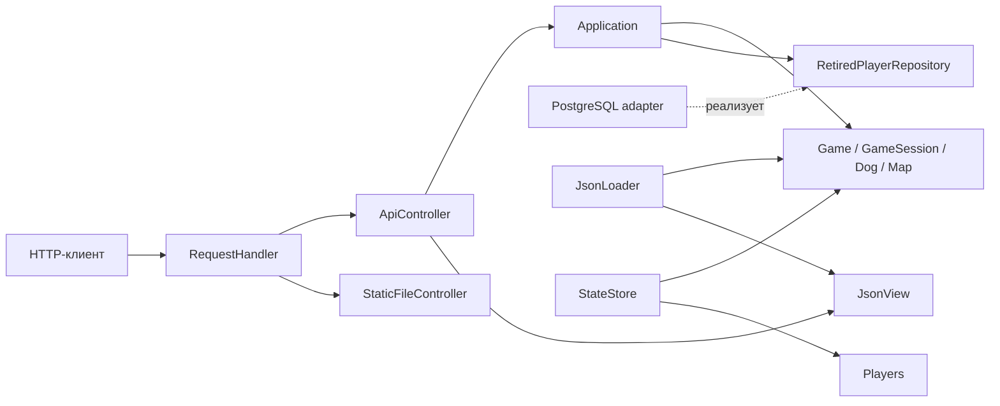

# Архитектура

Сервер использует MVC с отдельным прикладным слоем. Model составляют `domain`
и `application`: домен реализует игровые правила, приложение координирует сценарии.
Controller переводит HTTP-запросы в вызовы приложения. View формирует JSON-ответы;
браузерный клиент работает с ними через API.

## Границы ответственности

`domain` отвечает за карты, движение, столкновения, предметы, очки и игровое время.
Он не зависит от HTTP, JSON, PostgreSQL или файловой системы. Генератор предметов
принадлежит сессии и накапливает время между тиками. Модель проверяет допустимость
позиций, скоростей, вместимости сумки и числовых диапазонов. Доменные компоненты
находятся в заголовках `geometry_types`, `map`, `loot`, `dog`, `game_session` и `game`.

`Application` выполняет сценарии входа, авторизации, движения, чтения состояния
и продвижения времени. Результаты запросов — обычные C++-структуры со снимками
значений; представление не получает изменяемый указатель на игрока. При завершении
игры участника приложение записывает результат через `RetiredPlayerRepository`
и удаляет авторизацию. Репозиторий реализует требуемые операции хранения без
привязки приложения к SQL; в тестах используется реализация в памяти.

`ApiController` проверяет метод, авторизацию и входной JSON, вызывает сценарий
и выбирает HTTP-статус. `JsonView` отвечает за имена полей, структуру JSON и единицы
времени в ответах. Неизменяемые описания карт включают метаданные предметов,
необходимые клиенту, не вводя зависимость домена от JSON.

`RequestHandler` декодирует адрес и направляет запрос к API либо к статическим
файлам. Контроллеры, транспорт и журнал собираются в отдельные библиотеки;
допустимые локальные include проверяются `tools/check_architecture.py`.

`main.cpp` собирает приложение: создаёт конфигурацию, модель, репозиторий,
представление, контроллеры и HTTP-транспорт, определяет их время жизни и порядок
остановки. Прикладные алгоритмы находятся в домене и приложении.

## Выполнение и владение

Все операции API и таймер игры используют один Asio strand. Изменения игрового
состояния и обращения к единственному соединению PostgreSQL выполняются
последовательно. Статические файлы обслуживаются вне игрового strand.
Перед отправкой ответ передаётся в strand соответствующего сокета; сессия
и тело ответа живут до завершения асинхронной записи.

`Game`, `GameSession` и `Players` запрещают копирование агрегатов с живыми связями.
Коллекции доступны для чтения, структурные изменения выполняются методами модели.
`Database` использует pImpl: драйвер PostgreSQL и SQL-адаптер скрыты в реализации.
Копирование и перемещение владельца подключения запрещены, поэтому выданная ссылка
на репозиторий действует до уничтожения `Database`.

При входе токен выбирается до изменения сессии. Если регистрация игрока
не удаётся, добавленная собака удаляется без записи рекорда. Доставка проверяет
итоговый счёт до изменения сумки и очков. Успешный подбор удаляет предмет с карты
даже при ошибке последующего события; это не предполагает отката всего тика.

## Хранение состояния

Результаты завершённых игр записываются в PostgreSQL через Repository.
Активные сессии и авторизация сохраняются отдельно: `StateStore` сериализует
снимок во временный файл и затем заменяет итоговый файл переименованием.
Период сохранения измеряется игровым временем; запись выполняется при
`elapsed > period` после последнего успешного сохранения.

Восстановление сначала собирает временную модель и проверяет связи; ошибочный
снимок не изменяет целевую игру. При штатной остановке обработка запросов
прекращается, рабочие потоки присоединяются, затем записывается последний снимок.
При фатальном исключении фонового обработчика контекст останавливается, потоки
присоединяются, а процесс возвращает код 1 без замены последнего снимка.

## Стиль и документация

C++20, четыре пробела, Allman-скобки, строки до 120 символов.
Заголовки имеют расширение `.hpp`. Типы и методы используют
PascalCase, переменные — snake_case, закрытые поля — префикс `m_`. Форматтер
и правила проверки описаны в [кодстайле](codestyle.md). Стандартные интерфейсы
и точки расширения Boost используют предусмотренные библиотеками имена:
`what`, `serialize` и операторы.

Doxygen в заголовках описывает ответственность классов, владение зависимостями,
условия вызова и существенные ошибки методов.

## Ограничения

- Модель рассчитана на последовательные обращения внутри strand; её методы
  не поддерживают произвольные параллельные вызовы.
- PostgreSQL вызывается синхронно. Медленная база задерживает API и игровые тики.
- Активный мир, файловый снимок и таблица результатов не образуют общую транзакцию.
  Ошибка посреди тика не откатывает весь мир. При неопределённом результате COMMIT
  повторное сохранение не имеет гарантии идемпотентности и может создать дубликат
  результата.
- Снимок не хранит скорость движения и счётчики времени. После восстановления
  игрок стоит до новой команды, а отсчёт времени начинается заново. Атомарная
  замена файла не гарантирует сохранность при потере питания.
