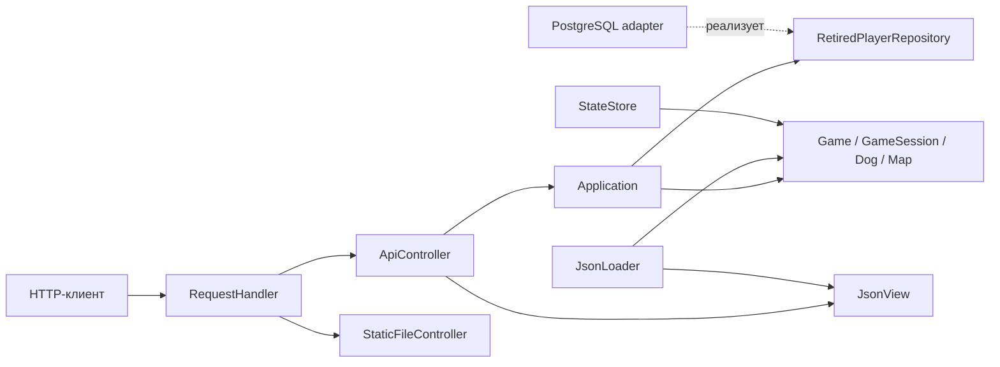

# Архитектура

## Границы ответственности

`domain` не знает об HTTP, JSON, PostgreSQL или файловой системе. Алгоритмы движения,
столкновений и подсчёта очков сохранены. Генератор предметов живёт в сессии
и накапливает время между тиками; период из конфигурации переводится из секунд
в миллисекунды. Бездействующие игроки удаляются по их фактическим индексам
в обратном порядке. Реализация разделена по картам, сущностям игроков, сессиям и игре.

`Application` выполняет операции и возвращает обычные C++-структуры. Результаты
запросов состояния — снимки значений; представление не получает изменяемый указатель
на игрока. При завершении сессии приложение пишет результат через интерфейс
`RetiredPlayerRepository`. Реализацию можно заменить в тестах без PostgreSQL.

`ApiController` проверяет метод, авторизацию и входной JSON, вызывает операцию и
выбирает HTTP-статус. Повторяющиеся ответы и разбор авторизации вынесены в общие
функции. `JsonView` отвечает за имена полей, JSON-структуру и единицы времени в
ответах. В представлении хранится неизменяемое описание карты: так сохраняются
дополнительные свойства предметов, необходимые клиенту, без включения JSON в домен.

`RequestHandler` декодирует адрес и направляет запрос к API либо к статическим
файлам. Все операции API выполняются внутри одного Asio strand. Тикер использует
тот же strand: изменения состояния и обращение к единственному соединению базы
не выполняются одновременно. Выдача статических файлов не занимает игровой strand.
HTTP-ответ передаётся обратно в strand соответствующего сокета перед началом записи.
Контроллеры, транспорт и журнал собираются в отдельные библиотеки; разрешённые
локальные include проверяются `tools/check_architecture.py`.

`StateStore` восстанавливает и записывает снимок; запись идёт во временный файл
с последующим переименованием. Порядок полей Boost.Serialization сохранён.
Период сохранения измеряется игровым временем; сохранено строгое условие `elapsed > period`.
Восстановление сначала собирает временную модель и проверяет связи; ошибочный снимок
не изменяет целевую игру. На штатном завершении обработчики HTTP останавливаются,
рабочие потоки присоединяются, и только затем записывается последний снимок.
При фатальном исключении фонового обработчика контекст останавливается, потоки
присоединяются, а процесс возвращает код 1 без перезаписи последнего снимка.

`main.cpp` — точка сборки приложения. Он создаёт конфигурацию, модель,
репозитории, представление, контроллеры и HTTP-транспорт; прикладных алгоритмов в нём нет.

## Стиль

C++20, четыре пробела, фигурные скобки на строке объявления, строки до 110 символов.
Правила форматирования закреплены в `.clang-format`, версия инструмента — в
`requirements-dev.txt`. Типы и основные методы используют PascalCase, переменные —
snake_case, закрытые поля — суффикс `_`. Существующие публичные имена, используемые
тестами или Boost.Serialization, сохранены.

Два коротких заголовка в корне `src` оставлены для совместимости путей включения
исходных тестов. Реальная реализация находится в `domain`.

## Ограничения

- Модель рассчитана на последовательные обращения внутри strand, а не на произвольные
  параллельные вызовы её методов.
- Обращения к PostgreSQL синхронные; медленная база задерживает операции API.
- Состояние активных сессий и таблица рекордов сохраняются разными механизмами;
  общей транзакции между файлом и базой нет.
- Текущий формат снимков не хранит скорость движения и счётчики времени;
  после восстановления нужна новая команда движения.

Эти особенности исходного поведения отделены от структурного рефакторинга.

Результаты подробного ревью и обоснования исправлений: [architecture-review.md](architecture-review.md).
