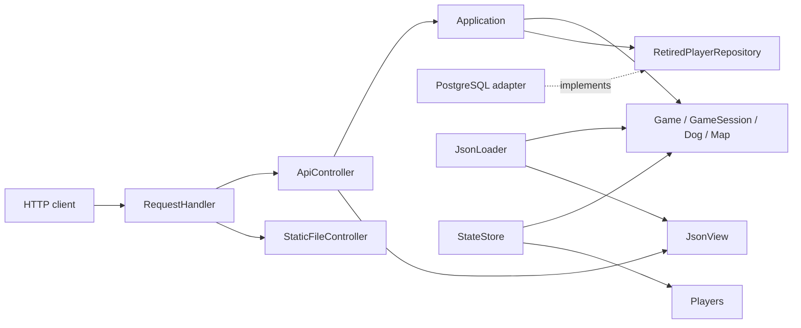

# Architecture

The server uses MVC with a separate application layer. The model consists of
`domain` and `application`: the domain implements game rules, and the application
coordinates use cases. The controller translates HTTP requests into application
calls. The view builds JSON responses, which the browser client consumes through the API.

## Responsibility boundaries

`domain` handles maps, movement, collisions, items, scores, and game time.
It does not depend on HTTP, JSON, PostgreSQL, or the file system. The item generator
belongs to a session and accumulates time between ticks. The model validates
positions, velocities, bag capacity, and numeric ranges. Domain components live
in the `geometry_types`, `map`, `loot`, `dog`, `game_session`, and `game` headers.

`Application` implements joining, authorization, movement, state queries, and
advancing time. Query results are plain C++ structures containing value snapshots;
the view does not receive mutable player pointers. When a player retires, the
application saves the result through `RetiredPlayerRepository` and removes their
authorization. The repository provides the required persistence operations without
coupling the application to SQL; tests use an in-memory implementation.

`ApiController` checks the method, authorization, and input JSON, invokes a use case,
and selects the HTTP status. `JsonView` owns field names, JSON structure, and time
units in responses. Immutable map descriptions include the item metadata needed
by the client without introducing a JSON dependency into the domain.

`RequestHandler` decodes the URL and routes the request to the API or static files.
Controllers, transport, and logging are built as separate libraries;
`tools/check_architecture.py` checks allowed local includes.

`main.cpp` assembles the application: it creates the configuration, model, repository,
view, controllers, and HTTP transport, and defines their lifetimes and shutdown order.
Application logic lives in the domain and application layers.

## Execution and ownership

All API operations and the game timer share one Asio strand. Changes to game state
and access to the single PostgreSQL connection execute sequentially. Static files
are served outside the game strand. Before a response is sent, it is handed over
to the corresponding socket strand; the session and response body remain alive
until the asynchronous write completes.

`Game`, `GameSession`, and `Players` prohibit copying aggregates with live references.
Collections are read-only to callers; model methods perform structural changes.
`Database` uses pImpl to hide the PostgreSQL driver and SQL adapter in its implementation.
The connection owner cannot be copied or moved, so a repository reference remains
valid until `Database` is destroyed.

A token is selected before the session changes during a join operation. If player
registration fails, the newly added dog is removed without recording a result.
Delivery validates the resulting score before modifying the bag or score.
A successful pickup removes the item from the map even if a later event fails;
this does not imply rollback of the entire tick.

## State persistence

Completed game results are written to PostgreSQL through a repository.
Active sessions and authorization are saved separately: `StateStore` serializes
a snapshot to a temporary file, then renames it to replace the destination file.
The save interval is measured in game time; a write occurs when `elapsed > period`
since the last successful save.

Recovery first builds a temporary model and validates its relationships; an invalid
snapshot does not change the target game. During normal shutdown, request processing
stops, worker threads are joined, and the final snapshot is written. A fatal
exception in a background handler stops the context, joins the threads, and exits
with code 1 without replacing the last snapshot.

## Style and documentation

C++20, four spaces, Allman braces, and a 120-character line limit.
Headers use the `.hpp` extension. Types and methods use PascalCase; variables use
snake_case; private fields use the `m_` prefix. Formatting and validation rules
are described in the [style guide](codestyle.md). Standard interfaces and Boost
extension points retain the names required by their libraries, such as
`what`, `serialize`, and operators.

Doxygen comments in headers describe class responsibilities, dependency ownership,
preconditions, and significant method errors.

## Limitations

- The model expects sequential access within the strand; its methods do not support
  arbitrary concurrent calls.
- PostgreSQL calls are synchronous. A slow database delays API requests and game ticks.
- The active world, file snapshot, and results table do not share a transaction.
  An error during a tick does not roll back the entire world. If the outcome of COMMIT
  is uncertain, retrying the save is not guaranteed to be idempotent and may create
  a duplicate result.
- Snapshots do not store velocity or time counters. After recovery, a player remains
  stationary until a new command arrives, and time counters start again. Atomic file
  replacement does not guarantee durability in a power failure.
